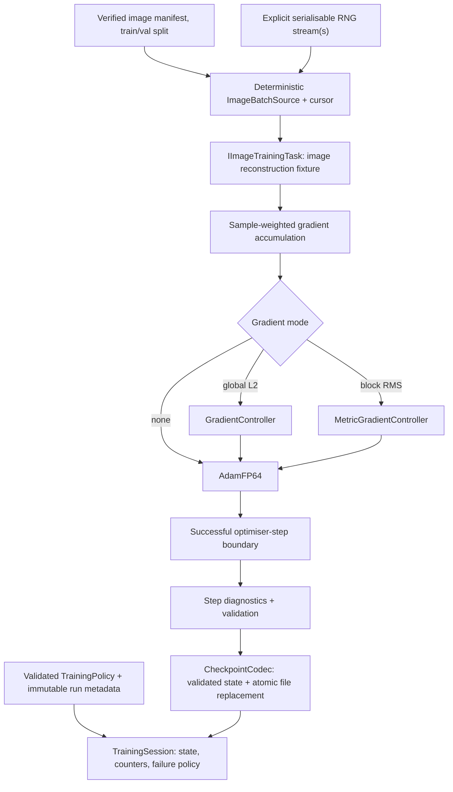

# NN.1.07E — Image-first training lifecycle and recoverable checkpoints

**Status:** Design and implementation checklist for review; no production C++ implementation committed by this document.  
**Target:** C++17, deterministic FP64 CPU reference.  
**Date:** 21 November 2026.  
**Dependencies:** NN.1.07A–D CPU tested (full CPU suite 20/20 reported), BUILD-01 hierarchical CMake.  
**Success condition:** A toy **image reconstruction** task can run, checkpoint, resume and produce the same model parameters and Adam state as an uninterrupted run. This is **not** yet a trained production autoencoder or image generator.

## 1. Product objective and sequence

The product target is image and, subsequently, video generation. Deliver **images first**. Images use a single spatial frame per example and can be represented by the current rank-4 `Tensor` as `[N,C,H,W]`. Video adds a time dimension, temporal consistency, larger datasets and typically more memory/compute; it will need a separately designed representation rather than assuming the current Tensor accepts rank 5. Parameter counts and costs depend on architecture and resolution, not solely on modality.

Sequence:
1. NN.1.07E: deterministic image-training *infrastructure* with toy image-reconstruction adapter.
2. AE track: actual image encoder/decoder, reconstruction objective and tests; prove useful reconstructions.
3. NN.2–NN.3: spatial epsilon-predictor and latent diffusion training, then sampling and image export. An autoencoder alone reconstructs input images; it does **not** generate new ones.
4. NN.1.07F: controlled image-training comparison across no clipping, global L2 and block-metric clipping.
5. Later: video-specific temporal data, models, training policy and benchmarks.

No image model, loader, VAE, learned denoiser, text-conditioning, guidance, GPU backend or video generation is claimed implemented by NN.1.07E.

## 2. Already available: exact integration boundaries

- `TrainingPolicy` currently contains `Objective::{ReconstructionMSE,EpsilonMSE}`, `GradientMode::{None,EuclideanGlobal,MetricRadial}`, batch/accumulation sizes, training intervals, provenance strings, seed and checkpoint switches.
- **Important:** `TrainingPolicy::validate()` currently **rejects** `execution_enabled == true`. NN.1.07E must introduce a narrowly gated execution-validation path without silently weakening existing policy-v1 tests. Keep unsupported objective/runtime modes rejected. Review whether policy v1 remains compatible or requires a new schema version; never silently change canonical serialisation.
- `Parameter` owns FP64 `values()` and `gradients()`; `Layer::backward()` accumulates gradients. Tensor permits rank 1–4 only.
- `AdamFP64::step()` stages its parameter/moment update and increments `step_count()` on success; `zero_grad()` leaves moments unchanged. **There is no public snapshot/export/import API for moment state.** Deterministic checkpoint/resume cannot be claimed until this is implemented and validated.
- `GradientController::apply(parameters)` and `MetricGradientController::apply()` mutate accumulated gradients. Any transactional session must prevent a controller mutation from surviving a failed optimiser step.
- Image model architecture (encoder, latent channels, resolution, decoder) remains in the AE and denoiser tracks; NN.1.07E orchestrates it, without inventing production image layers.

### NN.1.07E.04 runtime policy authorisation (implemented, CPU validation pending)

`TrainingPolicy` schema v1 remains immutable and intentionally disabled-only: `validate()`, `serialize()` and `parse()` reject `execution_enabled=true` exactly as specified by NN.1.07A. A separate `TrainingExecutionGate` copies the explicitly enabled request, validates all pre-existing policy fields through a disabled clone and verifies it against the actual `ImageDataset` manifest, canonical split roles, `ToyImageReconstructionTask` identity, image shape and parameter registration. The gate does not run training, create Adam state, serialise an enabled policy or mutate model state. Full-session checkpoint encoding and authorised execution belong to later E tickets; do not misrepresent the gate as a production trainer.

## 3. Architecture



### Image tensor and dataset contract

- `ImageBatch.images` has shape `[N,C,H,W]`, where `N,C,H,W > 0`. The first fixture uses small synthetic bounded FP64 images; a real image loader will be another ticket.
- Declare channel convention (RGB = 3), range (e.g. `[0,1]`) and fixed resolution **per run** in dataset/model metadata; do not bake a fixed image resolution into the generic session.
- A manifest names immutable sample identities, split membership and checksums. Split names alone are **not** evidence of no train/validation leakage.
- An image dataset adapter must have stable sample ordering, independent train/validation cursors, and serialisable shuffling RNG / epoch permutation.
- No implicit image augmentation in v1. Any future augmentation must be seeded, recorded and replayable.

## 4. States and failure semantics

```mermaid
stateDiagram-v2
 [*] --> Created
 Created --> Ready: validate and initialise OR restore
 Ready --> Accumulating: start window / clear gradients
 Accumulating --> Accumulating: validated image microbatch
 Accumulating --> Updating: window complete
 Updating --> Ready: clip + Adam step successful; counters commit
 Updating --> Failed: invalid loss, gradients, proposed step
 Ready --> Validating: validation interval
 Validating --> Ready: validation complete
 Ready --> Checkpointing: checkpoint interval
 Checkpointing --> Ready: atomic save complete
 Ready --> Completed: max successful optimiser steps
 Failed --> Ready: explicitly restore last valid boundary
```



**V1 safety contract:** A failed *window* must not masquerade as an optimiser step. Before any window, preserve (or provide a verified rollback mechanism for) parameter values, gradients, Adam moments/step count, data cursor and every RNG stream that can advance. On failure either (a) restore the entire boundary and retry deterministically or (b) enter `Failed` without committing any claimed progress. Never advance a checkpoint cursor while discarding gradient/window state. Avoid claiming model-level atomicity solely because `AdamFP64::step()` is atomic internally.

A checkpoint may be saved only at a **committed optimiser boundary**, with zero accumulated gradients, for v1. This intentionally avoids saving partially accumulated windows and their forward caches. Interrupted-window recovery replays from the prior committed checkpoint; the initial baseline can be the initialised session before step 1. Failure of checkpoint filesystem operations does not undo a successfully committed optimiser step in memory; report a checkpoint failure separately and retain the previous valid checkpoint.

## 5. Microbatch mathematics

For microbatch `j` containing `n_j` images and per-image loss `ell_i`, the mean loss and gradient for a window of `K` microbatches are:

```text
N = sum_j n_j
L_window = (1/N) sum_j sum_(i in j) ell_i
g_window = (1/N) sum_j n_j * gradient(mean_loss_j)
```

**Task contract:** `train_microbatch(batch, loss_scale)` accumulates `loss_scale * d(mean_loss_batch)/d(theta)` and returns the unscaled finite batch mean loss. The session supplies `loss_scale = n_j` during backward and divides the accumulated gradient tensors by `N` exactly once before clipping. Validate that scaling and the resulting gradients remain finite. The final partial accumulation window follows the same formula. A full 8-by-16 window has 128 images; a partial window does **not** pretend to contain 128.

The task must document whether it has internal forward caches and how it resets them on failure/resume; no stale cached batch is permitted after a restored checkpoint.

## 6. Proposed APIs (design only, not yet compiled)

### `latent/nn/training/ImageBatch.hpp`

```cpp
#pragma once
#include "latent/core/Tensor.hpp"
#include <cstddef>

namespace latent::nn::training {
struct ImageBatch {
    latent::core::Tensor images; // [N,C,H,W]
    std::size_t sample_count() const {
        if (images.rank() != 4) {
            throw std::invalid_argument("ImageBatch requires NCHW rank four");
        }
        return images.shape()[0];
    }
};
}
```

Add `<stdexcept>` and finite/range and image-contract validation in the implementation.

### `latent/nn/training/ImageTrainingTask.hpp`

```cpp
#pragma once
#include "latent/nn/training/ImageBatch.hpp"
#include "latent/nn/Parameter.hpp"
#include <string>
#include <vector>

namespace latent::nn::training {
class ImageTrainingTask {
public:
    virtual ~ImageTrainingTask() = default;
    virtual std::string task_id() const = 0;
    virtual std::vector<latent::nn::Parameter*> parameters() = 0;

    // Returns unscaled mean loss; accumulates loss_scale *
    // gradient of the microbatch mean objective.
    virtual double train_microbatch(
        const ImageBatch& batch, double loss_scale) = 0;

    // Held-out evaluation must not mutate parameter values,
    // accumulated training gradients or optimiser state.
    virtual double validation_loss(const ImageBatch& batch) = 0;

    // Forget any internal forward caches after failed execution.
    virtual void reset_transient_state() noexcept = 0;
};
}
```

The v1 fixture shall use a toy deterministic reconstruction model (e.g. one Linear layer over a flattened tiny image, with forward/backward explicitly adapting rank 4 to rank 2). This verifies training mechanics; architecture is NOT a real encoder/decoder.

### `latent/nn/training/TrainingSession.hpp`

```cpp
#pragma once
#include "latent/nn/training/TrainingPolicy.hpp"
#include "latent/nn/training/ImageTrainingTask.hpp"
#include <cstddef>
#include <cstdint>
#include <string>

namespace latent::nn::training {
enum class SessionPhase {
    Created, Ready, Accumulating, Updating,
    Validating, Checkpointing, Failed, Completed
};

struct StepMetrics {
    std::size_t optimiser_step = 0;
    std::size_t samples = 0;
    std::size_t microbatches = 0;
    double mean_training_loss = 0.0;
    double norm_before = 0.0;
    double norm_after = 0.0;
    double applied_scale = 1.0;
    bool clipped = false;
    std::string gradient_mode;
};

// Design API: depends on verified image source, serialisable
// RNG state and checkpoint/Adam snapshot contracts.
class TrainingSession final {
public:
    TrainingSession(
        TrainingPolicy policy,
        ImageTrainingTask& task
    );

    void initialise();
    StepMetrics run_one_window();
    void validate_once();
    void save_checkpoint(const std::string& path);
    void restore_checkpoint(const std::string& path);

    [[nodiscard]] SessionPhase phase() const noexcept;
    [[nodiscard]] std::size_t successful_steps() const noexcept;
private:
    TrainingPolicy policy_;
    ImageTrainingTask& task_; // non-owning; task must outlive session
    SessionPhase phase_ = SessionPhase::Created;
    std::size_t successful_steps_ = 0;
};
}
```

**Deliberate omission:** the complete constructor must also receive a dataset source, AdamFP64, RNG state owner and checkpoint codec. They are not implemented yet; do not compile or commit this skeleton as a working trainer.

### Required `AdamFP64` extension

```cpp
struct AdamSnapshot {
    std::uint32_t schema_version = 1;
    std::size_t step_count = 0;
    std::vector<latent::core::Tensor> first_moments;
    std::vector<latent::core::Tensor> second_moments;
};

// New Doxygen-documented methods proposed on AdamFP64:
// [[nodiscard]] AdamSnapshot snapshot() const;
// void restore(const AdamSnapshot& snapshot);
```

Restore must validate full shape/parameter order, finite moments, nonnegative second moments, step count and compatibility with Adam hyperparameters, **then commit all moment tensors and step count at once**. Do not attempt resume by only restoring `step_count()` and reinitialising moments. An additional tested state swap/transaction API may be required to provide whole-window rollback.

### `latent/nn/training/Checkpoint.hpp`

```cpp
struct TrainingCheckpointV1 {
    std::uint32_t schema_version = 1;
    std::string task_id;
    std::string policy_text;           // canonical policy record
    std::string dataset_manifest_digest;
    std::string code_revision;
    std::string metric_id;             // empty except metric mode
    std::vector<std::string> parameter_ids; // stable, unique
    std::vector<latent::core::Tensor> values;
    AdamSnapshot adam;
    std::string train_cursor_state;    // canonical, deterministic encoding
    std::string train_rng_state;       // complete engine state
    std::string task_rng_state;        // e.g. diffusion noise
    std::size_t epoch = 0;
    std::size_t successful_steps = 0;
    std::size_t images_seen = 0;
    bool has_best_validation = false;
    double best_validation_loss = 0.0;
};
```

At v1 boundaries gradients must be zero and no partial accumulation is checkpointed; record this invariant and reject incompatible payloads. Store full RNG engine state, **not just a seed**. Store parameter names/IDs and exact tensor shapes so that restoration cannot accidentally permute weights.

## 7. Checkpoint format and durability

- Versioned, bounded canonical payload with exact FP64 round-trip (either explicit binary IEEE-754 little-endian or strictly defined `max_digits10` textual encoding); verify platform and decode limits.
- Integrity digest over the full canonical payload; a non-cryptographic checksum catches accidental corruption but not tampering. If provenance/authenticity is a requirement, use a separately specified authenticated format.
- Reject truncated payload, unknown version, extra fields, impossible dimensions, excessive counts/sizes, NaN/Inf, mismatched task/model IDs, dataset digest, policy, optimiser hyperparameters, gradient mode and metric ID.
- Restore is a **read / parse / validate / stage / commit** transaction. The original in-memory session remains unchanged on rejected payloads.
- Save uses a same-directory temporary file, flushes file data, closes successfully, atomically renames to the destination, and (where supported) syncs the containing directory. State precisely whether the local filesystem supports those guarantees. Never overwrite the existing good checkpoint in place.
- Keep at least one previous known-good checkpoint; test simulated interrupted writes/rename failures. Do not save filesystem paths as proof of dataset content integrity.

## 8. Validation, reporting and comparisons

Record each committed optimiser step: step index, effective samples, mean training loss, controller mode/version, actual pre/post norm, scale, clipping boolean, cumulative clipped/rejected counts, elapsed computation (non-deterministic telemetry only), dataset digest and code revision. Validation uses held-out data, no backward/step, and must leave values, gradients, moments and training RNG/cursor unchanged.

Actual measured `GradientController` post-norm is still a follow-up; don't imply that baseline reports precise post-norm when it currently reports the target threshold. The metric controller's NN.1.07D measured post-norm is CPU validated.

`NN.1.07F` will compare image training with **identical model initial parameters, sample order, augmentation/noise streams, optimiser settings and budgets**, calibrating thresholds to compare clipping incidence fairly. Better numeric conditioning does not prove better image quality; use training/validation losses and actual reconstruction images in the AE track.

## 9. Acceptance and release gates

| Gate | Minimum evidence |
| --- | --- |
| E.01 | ImageBatch, source and manifest validation, no split leakage |
| E.02 | Task adapter and deterministic toy reconstruction backward/validation |
| E.03 | Sample-weighted accumulation, including partial windows |
| E.04 | Policy-enabled execution gate (existing disabled tests retained) |
| E.05 | None, Euclidean and metric controller selection and numerical telemetry |
| E.06 | AdamSnapshot transactional export/import, moments and hyperparameter identity |
| E.07 | Whole-window rollback or fail-closed semantics without false step/cursor commits |
| E.08 | Checkpoint codec, corruption/version/shape limits, atomic disk replacement |
| E.09 | Exact seeded replay: 10 uninterrupted steps vs 5 + checkpoint + 5 |
| E.10 | Failure injection: data, forward, backward, clipping, optimiser, save, restore |
| E.11 | CMake, CTest and Doxygen public interfaces, Debug full CPU and Release verification |
| E.12 | Initial toy-image training report (MSE reduction), no claim of generative image quality |

One or more new CTest executables may be registered in `tests/nn/CMakeLists.txt`; never assert a new test total until actual CMake registration is reviewed.

## 10. Proposed file ownership

```text
docs/IMAGE_TRAINING_LIFECYCLE_NN_1_07E.md  (this design)
checklists/NN_CHECKLIST.md                 (E.01–E.12)
latent/nn/training/ImageBatch.hpp
latent/nn/training/ImageTrainingTask.hpp
latent/nn/training/TrainingSession.hpp
latent/nn/training/TrainingMetrics.hpp
latent/nn/training/Checkpoint.hpp
src/nn/training/TrainingSession.cpp
src/nn/training/Checkpoint.cpp
src/nn/training/TrainingMetrics.cpp
latent/nn/AdamFP64.hpp                     (new snapshot contract)
src/nn/AdamFP64.cpp                        (transactional implementation)
tests/nn/test_image_training_session.cpp
tests/nn/test_checkpoint_roundtrip.cpp
tests/nn/test_adam_snapshot.cpp
src/nn/training/CMakeLists.txt
tests/nn/CMakeLists.txt
```

Review code before committing any production sources. Approve, implement and validate the E subtickets sequentially; document actual test evidence after each. Future video uses the validated session concepts but adds a separate temporal batch/data/task abstraction rather than violating `Tensor`'s rank-4 contract.
