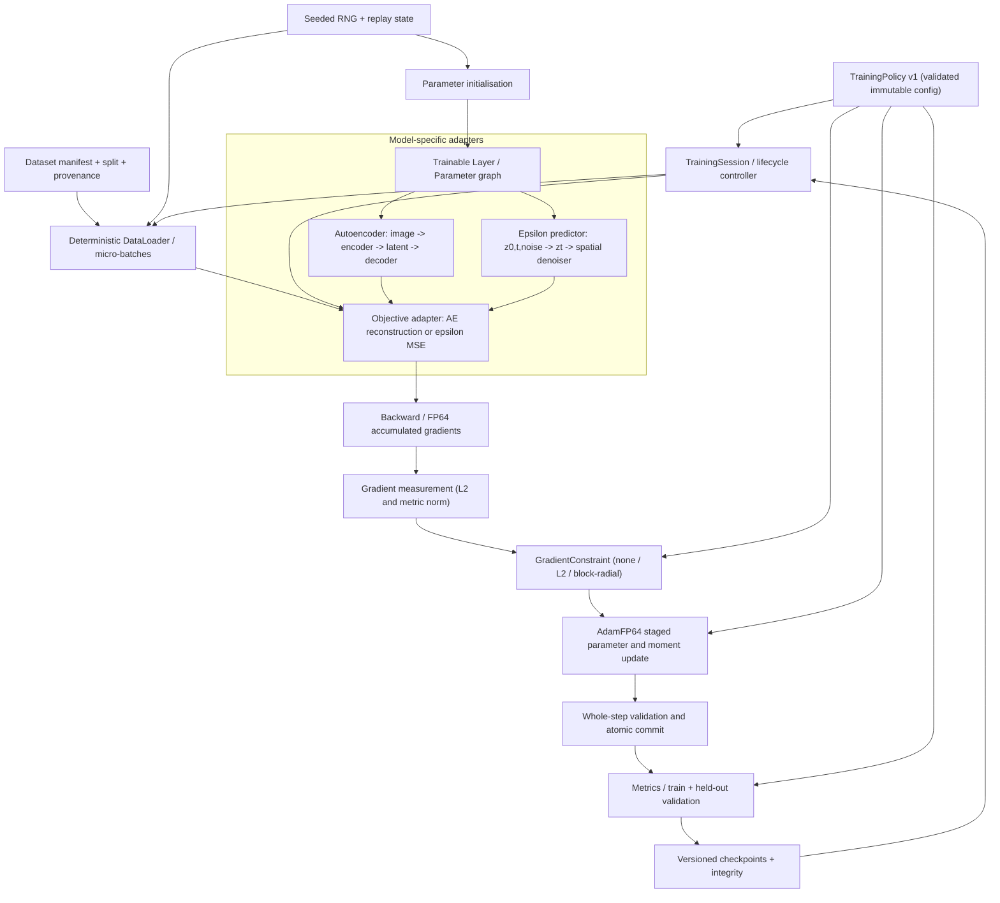
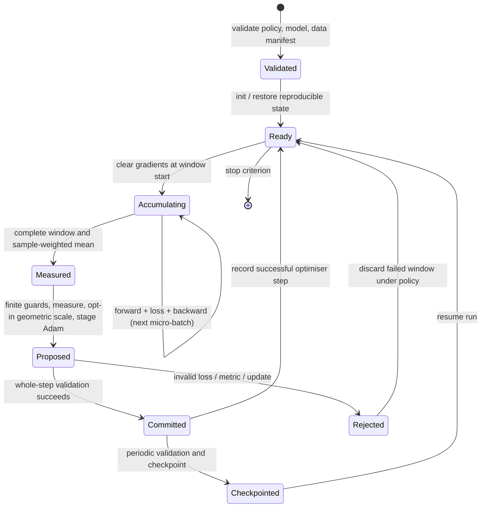

# Training Architecture — NN.1.07A Design v0.1

**Status:** Architecture proposal approved for documentation; implementation and numerical validation pending.  
**Target:** C++17 CPU FP64 reference implementation.  
**Scope:** Policy-controlled training for image autoencoder (AE.5–AE.6) and spatial epsilon predictor (NN.2–NN.3).  
**Related:** [NN checklist](../checklists/NN_CHECKLIST.md) · [AE checklist](../checklists/AUTOENCODER_CHECKLIST.md) · [Roadmap](../ROADMAP.md).

## Principles

1. **Policy before execution.** An immutable, versioned `TrainingPolicy` controls the trainer. Schema validation must succeed before a run begins.
2. **Model and trainer are separate.** Autoencoder reconstruction and latent epsilon prediction use different objectives, datasets and validation criteria, but share training-state machinery.
3. **Reproducibility is a contract.** Record initialisation and data-order seeds, RNG state, dataset manifest, policy version, code revision, numerical backend and deterministic resume position.
4. **Geometric clipping is opt-in and measured.** Standard unclipped and global Euclidean clipping runs remain controlled comparators. No geometric metric is assumed to improve model quality.
5. **A complete optimiser step is a transaction.** Reject numerical failures without leaving partially updated model parameters, Adam moments or accumulated gradients. Defining rollback across gradient control and optimiser is NN.1.07E work, not a feature of the present code.
6. **Training is not sampling.** The diffusion core accepts externally supplied epsilon today; a genuinely trained epsilon network and image decoder remain separate milestones.

## Logical component architecture



> This is a **logical architecture**, not a claim that these classes or adapters already exist. The only currently validated optimiser is `AdamFP64`; a transactional boundary spanning geometric constraint and optimiser remains to be implemented.

## Model architecture boundaries

### Autoencoder track (AE)

```
Image [N,3,32,32] -> ImageEncoder -> Latent [N,C,8,8]
                    -> ImageDecoder -> Reconstruction [N,3,32,32]
Objective: initially reconstruction MSE; additional losses require separate approval.
```

Spatial latent channel count `C`, encoder/decoder blocks, latent scaling, and non-MSE quality losses are **not yet fixed**. They are owned by AE.2 and later AE tickets; do not conflate the training controller with the image model architecture.

### Epsilon-prediction track (NN.2)

```
z0 [N,C,8,8] + timestep t + sampled epsilon
    -> q_sample(z0, t, epsilon) -> zt [N,C,8,8]
    -> spatial epsilon predictor(zt,t) -> epsilon_hat [N,C,8,8]
Objective: mean squared error(epsilon_hat, epsilon).
```

The denoiser (CNN/residual blocks, timestep embedding, conditioning and channel widths) will be specified and validated in NN.2. A policy must not assert that those modules already exist. Autoencoder latent scaling must be locked before final denoiser training.

## Policy and proposed defaults (research configuration)

| Setting | Proposed value | Notes |
| --- | --- | --- |
| Backend / precision | CPU / FP64 | Reference implementation; no Metal parity claim |
| Optimiser | AdamFP64 | Existing production layer, no weight decay |
| Learning rate | 0.001 | Fixed for first benchmark; validate empirically |
| Adam beta1 / beta2 / epsilon | 0.9 / 0.999 / 1e-8 | Validated optimiser defaults |
| Micro-batch | 16 | Subject to memory limits |
| Accumulation | 8 | Effective batch 128 **only for 8 full micro-batches** |
| Loss reduction | Sample-weighted mean | Correct handling of final partial window |
| Dataset seed | 42 | Example, explicit in run manifest |
| Gradient mode | metric_radial | **Not executable until NN.1.07D is validated** |
| Gradient norm threshold | 1.0 | Uncalibrated; record activation frequency |
| Metric | equal_block_rms_v1 | Fixed within run, one positive-definite block per Parameter |
| Update trust region | none | NN.1.07G is independent and experimental |
| Training enabled | false | Until policy, metric and execution engine pass review |

**Distinction:** The configuration is a selected **experiment**; the safe schema default for gradient control is `none`. The run must explicitly request `metric_radial`, including a matching metric version.

## Block-diagonal geometry

Let `B` be the number of registered non-empty unique parameter tensors. Tensor `b` has `d_b > 0` scalar entries and gradient vector `g_b`.

Define the SPD metric with one diagonal block per tensor:

```text
M = diag(M_1, ..., M_B)
M_b = I_(d_b) / (B * d_b)
||g||_M = sqrt( (1/B) * sum_b [ (1/d_b) * sum_i g_(b,i)^2 ] )
s = min(1, c / ||g||_M)   for ||g||_M > 0
g'_b = s * g_b
```

At zero norm `s = 1`. One **global** scale `s` preserves the concatenated gradient direction. This is metric-radial clipping, **not generally the Euclidean closest-point projection** onto an ellipsoid. It weights each parameter tensor's RMS gradient equally, not each parameter or each direction by real predictive sensitivity. Small bias tensors may therefore be overrepresented; that is a hypothesis to measure.

Measurement must avoid `g*g` FP64 overflow via scaled sum of squares / stable norm accumulation. Validate non-finite gradients and metrics before mutation; stage *all* clipped gradients and commit together. Stable parameter registration order and exact tensor-shape identities are required. If metric version, block ordering or shapes change during a run, reject or explicitly start a new run.

## Execution lifecycle



* One micro-step is one forward/backward over a micro-batch. One optimiser step is one **successful committed** update.
* For full 16-sample micro-batches, average 8 mean-loss gradients with a factor of 1/8. For a partial window, weight each contribution by actual sample count divided by total samples in the window.
* Clip **after** accumulation, before Adam. Log pre/post L2 and metric norms, global scale, clipping frequency, actual Adam parameter displacement, and rejected steps.
* The current AdamFP64 transaction covers its own parameter/moment updates, **not** a prior mutation of gradients by clipping. NN.1.07E must stage or snapshot/restore the entire window to make the proposed cross-component rejection guarantee true.
* Whether a rejected step consumes RNG/data cursor state must be explicit in the policy and checkpoint. Never silently claim bit-identical replay if that state is lost.
* Validation must be held-out, deterministic and must not mutate training optimiser state.

## Suggested C++ module boundaries (future, not committed code)

```text
latent/nn/training/
    TrainingPolicy.hpp       # typed schema, version and validation
    TrainingSession.hpp      # lifecycle and transactional step orchestration
    GradientController.hpp   # read-only measurement + staged constraints
    Metric.hpp               # block definitions, metric ID, positive checks
    Objective.hpp            # common interface, separate AE and epsilon adapters
    TrainingState.hpp        # counters, RNG cursor, checkpoint metadata
src/nn/training/
    TrainingPolicy.cpp
    TrainingSession.cpp
    GradientController.cpp
    Metric.cpp
    TrainingState.cpp
tests/nn/
    test_training_policy.cpp
    test_gradient_euclidean.cpp
    test_gradient_metric.cpp
    test_training_lifecycle.cpp
    test_training_resume.cpp
```

Paths are proposed structure only. Existing `latent/nn/AdamFP64.hpp`, `latent/nn/Parameter.hpp`, `Linear`, `Conv2D`, Tensor and diffusion-core APIs remain unchanged through NN.1.07A.

## Test strategy and milestone gates

| Ticket | Validation gate |
| --- | --- |
| NN.1.07A | Schema/version rejection; deterministic parsing and serialisation; incompatible policy detection; Doxygen contracts |
| NN.1.07B | Seeded repeatability, finite parameter initialisation, fixed fan-in/out assumptions |
| NN.1.07C | Euclidean known answers, direction preservation, threshold/zero handling, overflow-safe measurement |
| NN.1.07D | Independent block-norm fixtures, SPD/shape/ordering checks, atomic clipping, matched Euclidean reference |
| NN.1.07E | Window accumulation, whole-step reject/commit, checkpoint integrity, exact seeded resume |
| NN.1.07F | Deterministic toy smoke test, independent held-out AE and epsilon objectives, matched no-clipping/L2/metric comparison |
| NN.1.07G | Experimental control on *actual* proposed Adam displacement, separate from gradient clipping |

Never infer AE training success, generative image quality, Doxygen build success, Release verification or Metal parity from the existing 16/16 CPU tests.

## Approval / document status

This document records the reviewed *design direction* only. No new C++ training modules, metrics or regression tests are implemented or signed off by adding this architecture. Specific schema choices, metric weighting and execution semantics remain subject to NN.1.07A implementation review.
